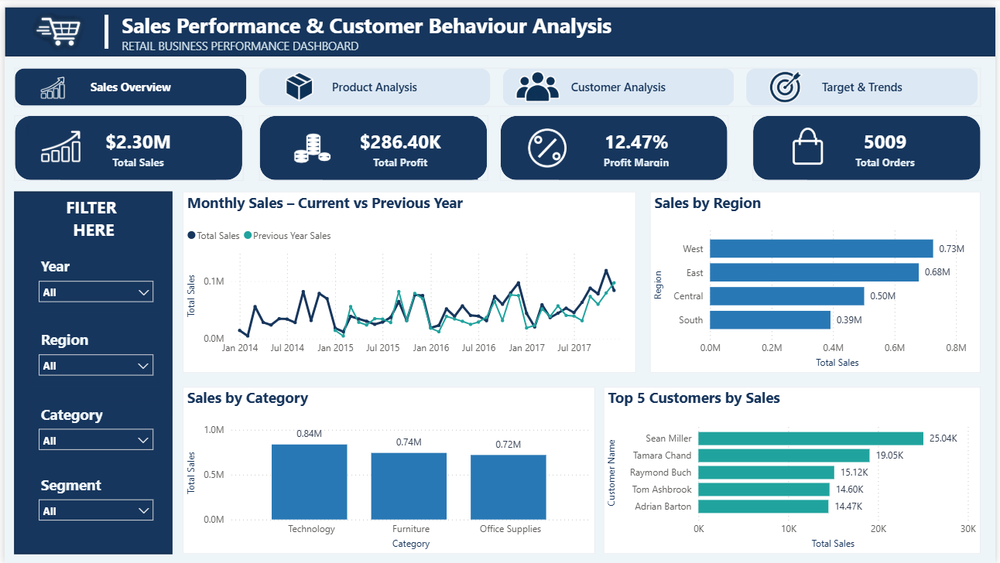
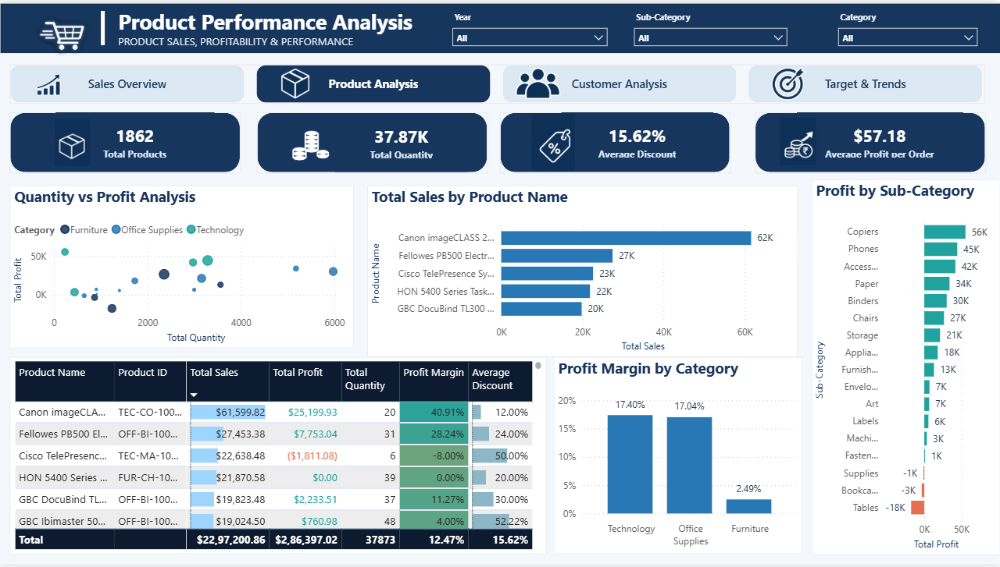
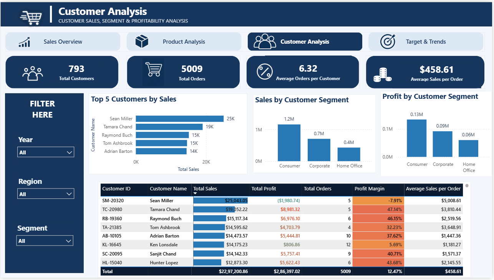
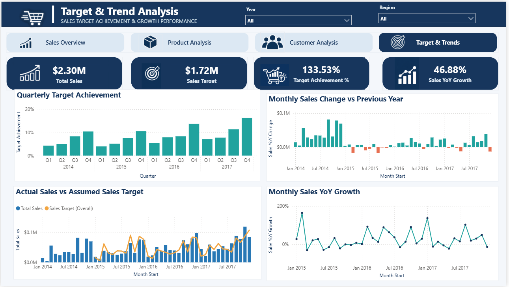
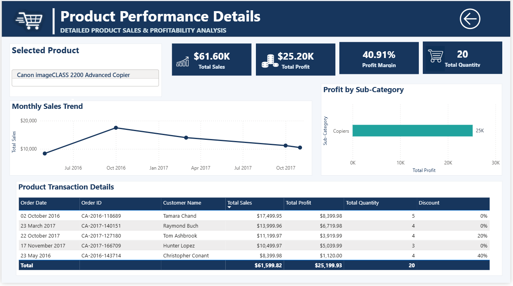
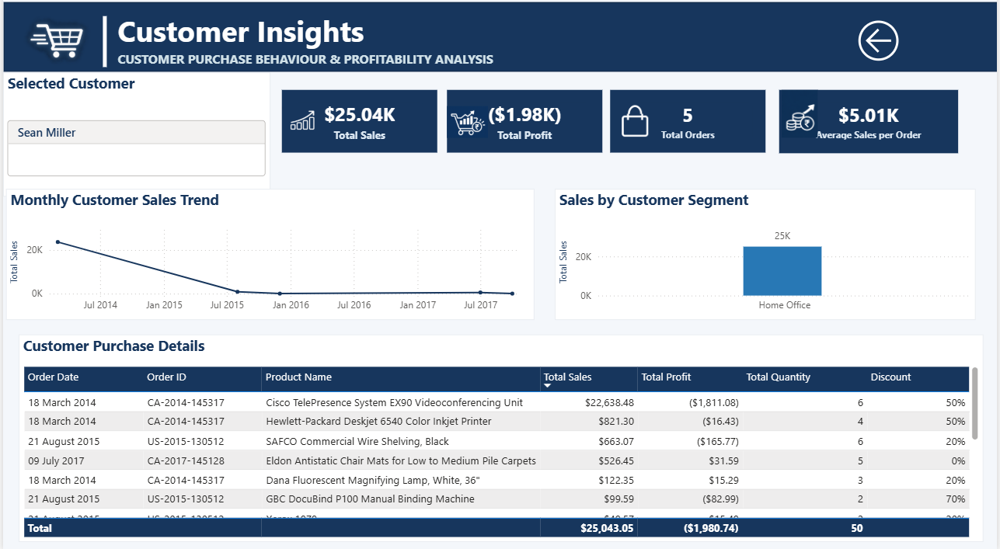

# Sales Performance & Customer Behaviour Analysis

## 📊 Project Overview

This project focuses on analysing sales performance, product profitability, customer purchasing behaviour, and sales target achievement using Microsoft Power BI.

An interactive six-page dashboard was developed to transform raw sales data into meaningful business insights and support data-driven decision-making.

## 🎯 Project Objectives

- Analyse overall sales and profitability.
- Evaluate product and sub-category performance.
- Understand customer purchasing behaviour.
- Monitor sales performance against targets.
- Identify sales and profit trends over time.
- Explore individual product and customer performance using drill-through analysis.

## 🛠️ Tools & Technologies

- Microsoft Power BI
- Power Query
- DAX (Data Analysis Expressions)
- Data Modelling
- Data Visualisation
- GitHub

## 📁 Dataset

- **Dataset:** Sample Superstore
- **Source:** Kaggle
- **Author:** Vivek468
- **File:** Sample - Superstore.csv
- **Records:** 9,994 rows
- **Columns:** 21

**Dataset Link:** [Superstore Dataset Final – Kaggle](https://www.kaggle.com/datasets/vivek468/superstore-dataset-final)

## 📈 Dashboard Pages

The Power BI report consists of six interactive pages.

1. **Sales Overview** – Provides an overview of key sales and profitability metrics.
2. **Product Analysis** – Analyses product and sub-category performance.
3. **Customer Analysis** – Examines customer performance and purchasing behaviour.
4. **Sales Target Analysis** – Compares actual sales against sales targets.
5. **Product Performance** – Provides detailed product-level analysis through drill-through.
6. **Customer Insights** – Provides detailed customer-level analysis through drill-through.

## 🖼️ Dashboard Preview

### 1. Sales Overview



### 2. Product Analysis



### 3. Customer Analysis



### 4. Sales Target Analysis



### 5. Product Performance



### 6. Customer Insights



## 🧹 Data Preparation & Cleaning

Data preparation and transformation were performed using Power Query in Microsoft Power BI.

Key activities included:

- Promoted the first row as column headers.
- Corrected column data types.
- Used Change Type with Locale where required.
- Applied Trim transformations to remove unnecessary leading and trailing spaces.
- Applied Clean transformations to remove unwanted non-printable characters.
- Verified date, numerical and text data types.
- Checked the cleaned dataset for errors.
- Retained negative-profit records for accurate profitability analysis.

After data preparation, the cleaned dataset contained 9,994 rows with no errors.

## 🏗️ Data Modelling

A relational data model was developed in Power BI to support efficient analysis.

The model includes:

- **Fact_Sales:** Contains transactional sales information, including sales, profit, quantity, product and customer details.
- **Dim_Date:** Supports daily and yearly date analysis.
- **Dim_Month:** Supports monthly sales and target comparisons.
- **Sales_Target:** Contains monthly sales target information.

Relationships were established between the fact table and the relevant date and month dimension tables to enable accurate filtering and reporting.

## 🧮 DAX & Measures

DAX was used to calculate important business metrics, including:

- Total Sales
- Total Profit
- Total Quantity
- Total Orders
- Profit Margin
- Average Sales per Order
- Sales Target
- Target Achievement Percentage

Additional measures were developed for overall target analysis.

## ⚡ Interactive Features

- Interactive slicers and filters
- Page navigation
- Product drill-through
- Customer drill-through
- Dynamic KPI calculations
- Monthly sales trend analysis
- Product and customer-level detailed analysis

## 📂 Repository Structure

```text
Sales-Performance-Customer-Behaviour-Analysis/
│
├── 01_Dataset/
│   ├── Raw/
│   └── Processed/
│
├── 02_PowerBI/
│   ├── Sales_Performance_Customer_Behaviour.pbix
│   └── Screenshots/
│
├── 03_Data_Model/
│   ├── Data_Model_Diagram.png
│   └── Data_Model_Documentation.md
│
├── 04_DAX/
│   ├── Measures.md
│   └── Calculated_Columns.md
│
├── 05_Documentation/
│   ├── Project_Overview.md
│   ├── Data_Dictionary.md
│   └── Business_Insights.md
│
├── 06_Presentation/
│   └── Project_Presentation.pptx
│
├── 07_Reports/
│   └── Final_Project_Report.pdf
│
├── .gitignore
└── README.md
```

## 📦 Project Deliverables

- Interactive Power BI dashboard
- Data model diagram and documentation
- DAX measures and calculated columns documentation
- Project overview and data dictionary
- Business insights documentation
- Project presentation
- Final project report

## 📝 Conclusion

This project demonstrates the practical application of Microsoft Power BI for data preparation, data modelling, DAX calculations, interactive dashboard development, and business performance analysis.

It provides an opportunity to explore sales, profitability, product performance, customer behaviour, and target achievement through interactive data visualisation.